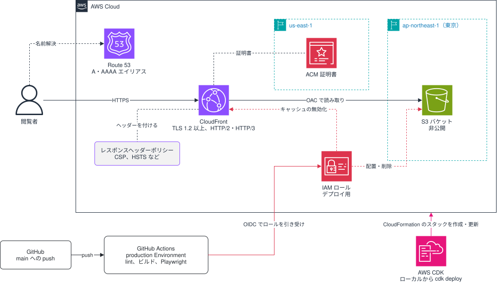

# takedah-portfolio

takedah のポートフォリオサイトのソースコードと、サイトを配信する AWS のインフラの定義です。

サイト：https://portfolio.dev.morori.jp/

## 構成



- 閲覧：閲覧者は Route 53 でドメイン名を解決して CloudFront に接続します。CloudFront は、非公開の S3 バケットから OAC でファイルを読み取って配信します。証明書は us-east-1 の ACM で発行し、セキュリティヘッダーは CloudFront のレスポンスヘッダーポリシーで付けます。
- デプロイ：main ブランチへの push で GitHub Actions が動き、テストに通ったビルドを S3 に配置して、CloudFront のキャッシュを無効化します。AWS の認証には OIDC を使い、長期のアクセスキーは使いません。
- インフラ：AWS CDK で 2 つのスタック（us-east-1 の証明書と、東京リージョンのサイト）を管理し、ローカルからデプロイします。

設計の詳しい説明は、サイトの Architecture セクションにあります。

## ディレクトリ構成

| ディレクトリ | 内容 |
|---|---|
| `web/` | サイト（React、TypeScript、Vite）。`e2e/` にブラウザテスト |
| `infra/` | AWS CDK のアプリ。設定は `lib/config.ts` にまとめています |
| `docs/` | 構成図の元データ（`architecture.drawio`） |
| `.github/` | デプロイと CI のワークフロー、Dependabot の設定 |

## 使っている技術

- サイト：React、TypeScript、Vite、Tailwind CSS、Motion、lucide-react
- デザイン：デジタル庁デザインシステムのテーマ（`@digital-go-jp/tailwind-theme-plugin`）、Noto Sans JP
- テスト：Playwright（サイト）、Jest（CDK）
- インフラ：AWS CDK、Amazon S3、Amazon CloudFront、AWS Certificate Manager、Amazon Route 53、AWS IAM
- CI/CD：GitHub Actions、Dependabot

## ローカルでの開発

Node.js 22 が必要です。

```sh
cd web
npm ci
npm run dev        # 開発サーバー
npm run lint
npm run build
```

ブラウザテストは、本番と同じ CSP をすべての応答に付けて、デスクトップとスマートフォンの画面サイズで実行します。初回だけ Chromium をインストールしてください。

```sh
npx playwright install chromium
npm run test:e2e   # ビルドしてからテストを実行します
```

## インフラ

### CDK の外で用意するもの

- Route 53 のパブリックホストゾーン（`dev.morori.jp`）
- GitHub Actions 用の IAM OIDC プロバイダー（URL は `https://token.actions.githubusercontent.com`、対象者は `sts.amazonaws.com`）

同じ URL の OIDC プロバイダーはアカウントに 1 つしか作れないため、CDK では作らずに参照しています。

### デプロイ

ブートストラップは、東京リージョンと us-east-1 の両方で必要です。

```sh
cd infra
npm ci
npx cdk bootstrap --profile <プロファイル名> aws://<アカウント ID>/ap-northeast-1 aws://<アカウント ID>/us-east-1
npm test
npx cdk diff --profile <プロファイル名>
npx cdk deploy --all --profile <プロファイル名>
```

デプロイ先のアカウントは、`--profile` で指定したプロファイルの資格情報から決まります（`bin/infra.ts` は `CDK_DEFAULT_ACCOUNT` を使っています）。

## サイトのデプロイ

`web/` か `.github/workflows/deploy.yml` を変更して main に push すると、Deploy ワークフローが次の順に実行します。

1. lint、ビルド、Playwright のテスト
2. OIDC でデプロイ用の IAM ロールを引き受ける
3. ハッシュ付きのファイルを `Cache-Control: public, max-age=31536000, immutable` で配置する
4. それ以外のファイルを `Cache-Control: no-cache` で配置する
5. CloudFront のキャッシュを無効化する
6. 今のビルドで使わないアセットのうち、アップロードから 30 日たったものを消す

ワークフローは GitHub の production Environment で動きます。Environment には、デプロイできるブランチを main だけに限るルールと、次の変数を設定します。値は `cdk deploy` の出力（PortfolioSite スタックの Outputs）で確かめられます。

| 変数 | 値 |
|---|---|
| `AWS_ROLE_ARN` | `DeployRoleArn` |
| `S3_BUCKET` | `BucketName` |
| `CLOUDFRONT_DISTRIBUTION_ID` | `DistributionId` |

## 運用メモ

- 構成図を直すときは `docs/architecture.drawio` を draw.io で編集し、`web/src/assets/architecture.svg` に SVG として書き出します。書き出すときは、背景を白にし、図のコピーとフォントは含めません。ラベルの折り返し（`whiteSpace=wrap`）を使うと HTML のラベルが書き出されるので、使わないでください。
- Dependabot は、`web/` の TypeScript のマイナーとメジャーの更新を対象から外しています。typescript-eslint が TypeScript 6.1 以降に対応したら、`.github/dependabot.yml` の `ignore` から外してください。
- `@types/node` のメジャーの更新も対象から外しています。実行環境の Node.js のメジャーバージョンを上げるときに、手動で合わせてください。
- minimatch の脆弱性のアラートは、minimatch を使っているパッケージ（aws-cdk-lib と typescript-eslint）が修正版の 11 に対応していないため、許容できるリスクとして閉じています。ときどき `npm ls minimatch` で、修正版（11.0.1 以降）に上がったかを確かめてください。

## ライセンス

コードは [MIT ライセンス](LICENSE) です。ただし、次のものはライセンスの対象外です。

- `web/src/data/` にあるプロフィール、経歴、記事などの文章
- `web/public/badges/` の資格のバッジの画像（AWS の商標を含みます）
- 猫の写真（`web/src/assets/avatar.jpg`、`web/public/favicon.png`、`web/public/apple-touch-icon.png`）
